# SportRental — Система аренды спортивного инвентаря

Десктопное клиент-серверное приложение для автоматизации процессов проката спортивного оборудования. Система разделена на роли и позволяет управлять каталогом, бронированиями и статусами заявок.

## Скриншоты

### Окно авторизации
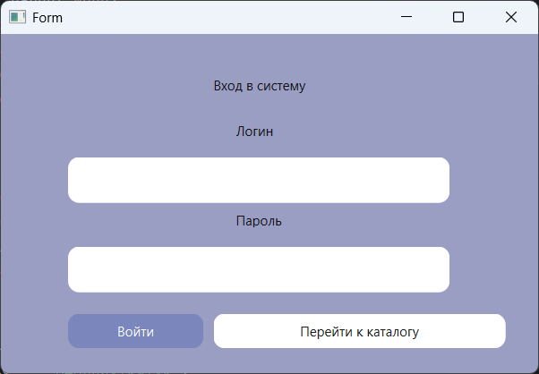

### Панель для гостя


### Панель администратора
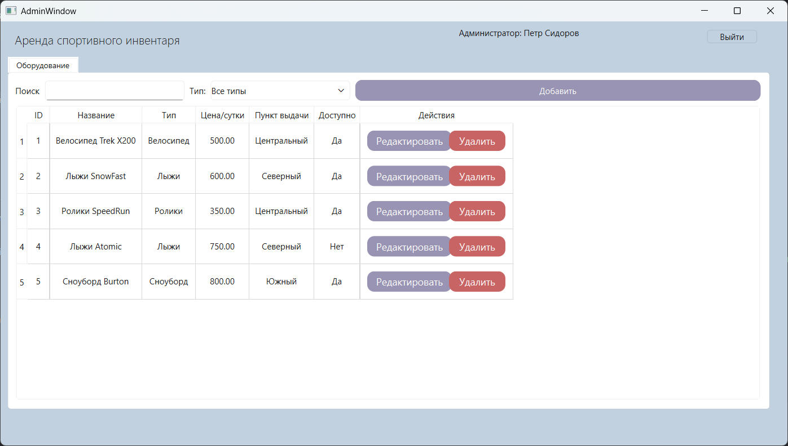
#### Поиск и фильтрация
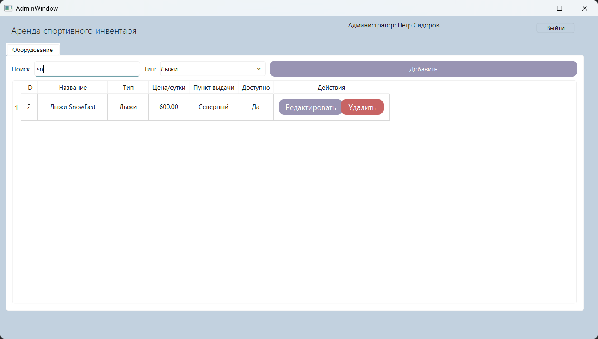
#### Добавление нового инвентаря
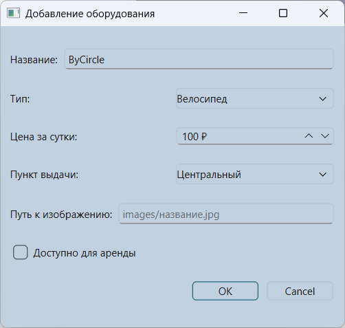

### Панель менеджера
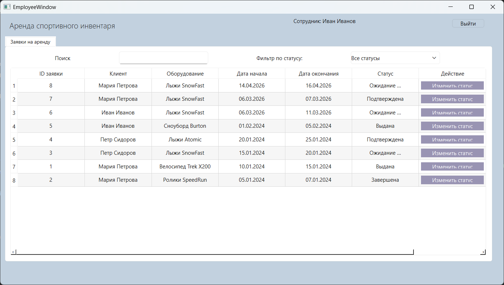
#### Поиск и фильтрация
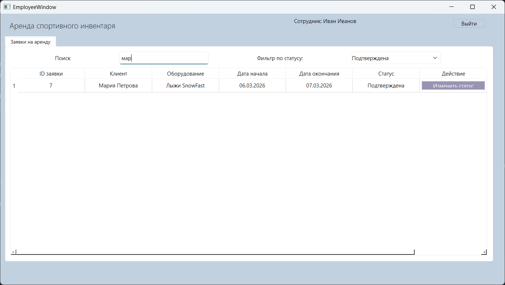
#### Изменение статуса заявки
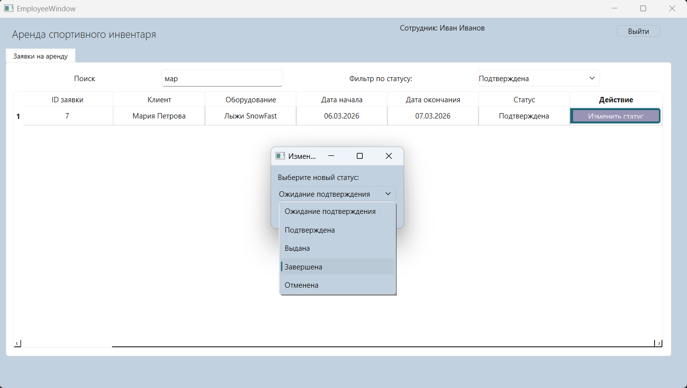
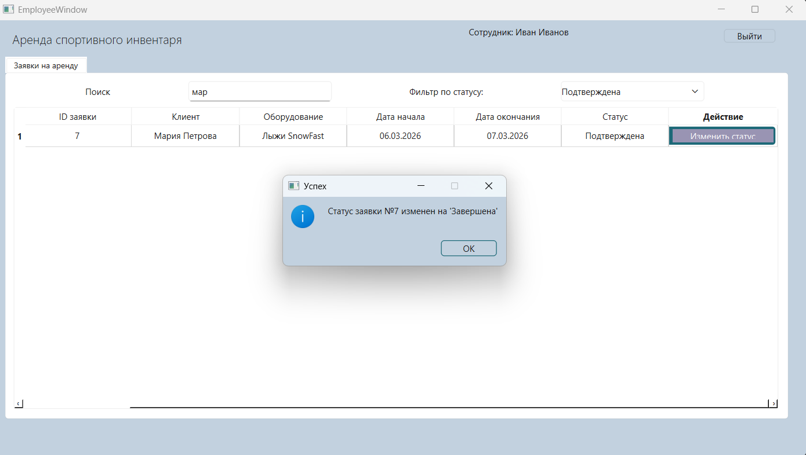

## Панель клиента
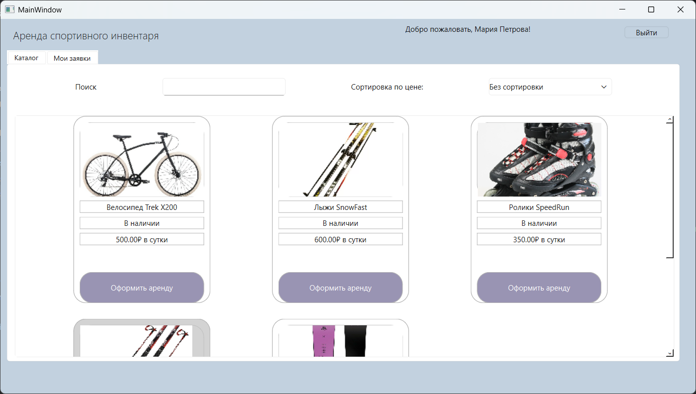
#### Поиск и сортировка по цене
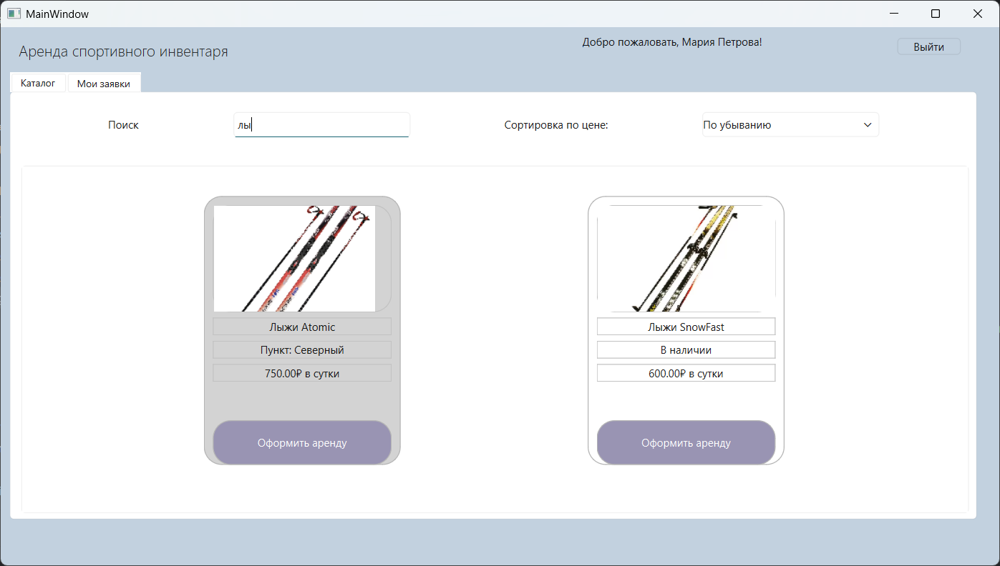
#### Заявка на аренду инвентаря
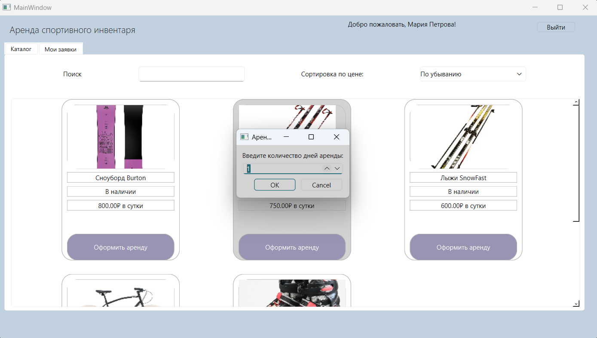
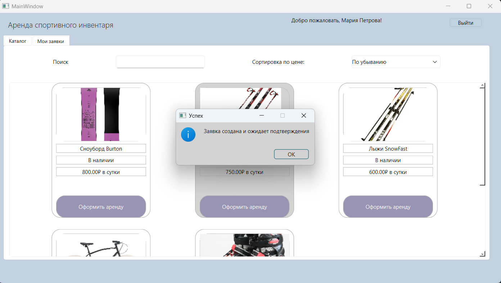
#### Просмотр списка заявок
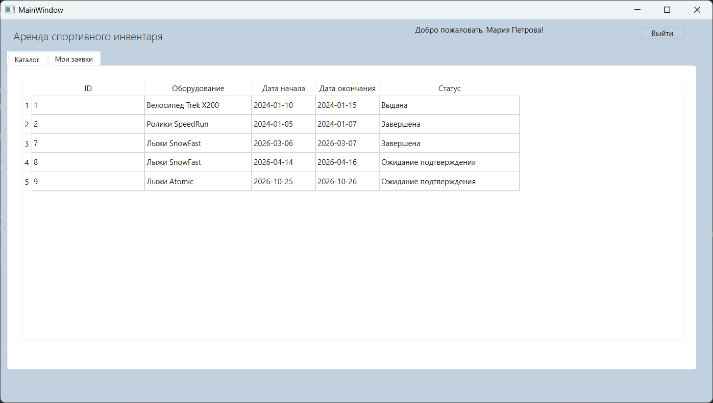

## Стек технологий
- **Язык:** Python 3
- **UI-фреймворк:** PyQt6
- **База данных:** MySQL (через библиотеку `pymysql`)
- **Архитектура:** MVC

## Функционал (Ролевая модель)

Приложение поддерживает 4 роли (Гость, Клиент, Сотрудник, Администратор), каждая со своим интерфейсом:

### 1. Гость / Клиент
- Просмотр каталога доступного спортивного инвентаря (карточки с фото, названием, ценой и статусом).
- Поиск по названию и сортировка по цене (возрастание/убывание).
- Создание заявки на аренду (выбор количества дней, автоматический расчет даты начала и окончания).
- Просмотр личного кабинета со списком своих заявок и их статусов.

### 2. Сотрудник (Employee)
- Просмотр всех заявок от клиентов (таблица с ФИО клиента, названием инвентаря, датами и статусом).
- Поиск заявок по имени клиента или названию товара.
- Фильтрация заявок по статусу (Ожидание, Подтверждена, Выдана, Завершена, Отменена).
- Изменение статуса заявки. При статусе «Выдана» оборудование автоматически становится недоступным, при «Завершена» — снова доступным.

### 3. Администратор (Admin)
- Управление каталогом оборудования: добавление, редактирование и удаление позиций.
- Валидация при удалении: нельзя удалить инвентарь, если на него есть активные заявки.
- Просмотр статистики и полной таблицы инвентаря с пунктами выдачи.

## Структура проекта

```text
sport-rental/
├── images/                 # Изображения для карточек товаров
├── ui_py_files/            # Сгенерированные файлы интерфейса из Qt Designer (.py)
├── ui_files/               # Файлы интерфейса из Qt Designer
├── main.py                 # Точка входа, окно авторизации
├── admin_win.py            # Логика окна администратора
├── employee_win.py         # Логика окна сотрудника
├── guest_client_win.py     # Логика окна клиента/гостя
├── product_card_widget.py  # Кастомный виджет карточки товара
├── bd.py                   # Модуль подключения к БД и функции запросов
├── sport_rental.sql        # Дамп базы данных (структура и тестовые данные)
└── requirements.txt        # Зависимости
```

## Как запустить
Клонируйте репозиторий:
```
git clone https://github.com/anarkulovab/sport_rental_python_.git
cd sport-rental-python_desktop_app
```

Установите зависимости:
Убедитесь, что у вас установлен Python 3.9+. Выполните:
```
pip install -r requirements.txt
```

Настройте базу данных MySQL:
1. Запустите сервер MySQL (OpenServer, MySQL Workbench)
2. Импортируйте базу данных из файла sport_rental.sql
3. База данных называется sport_rental
4. По умолчанию в файле bd.py настроено подключение: хост localhost, пользователь root, пароль root. Если ваши настройки отличаются, измените их в bd.py.

Запустите приложение:
```
python main.py
```

Тестовые аккаунты (из базы данных)
Для проверки функционала используйте следующие логины и пароли:

- Администратор: логин admin, пароль pass123
- Сотрудник: логин employee, пароль pass123
- Клиент: логин client, пароль pass123

Гость: просто нажмите кнопку «Перейти в каталог» на экране входа